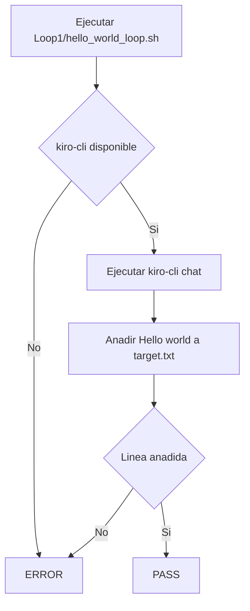

# Loop 1: Hello World Loop

Un primer loop extremadamente simple.

## Flujo



## Ejecutar

```sh
sh Loop1/hello_world_loop.sh
```

El script solicita a Kiro CLI que añada una línea `Hello, world!` a `target.txt`. Cada ejecución agrega una nueva línea, siempre. El script verifica que la línea fue añadida correctamente e imprime `PASS` al terminar.
