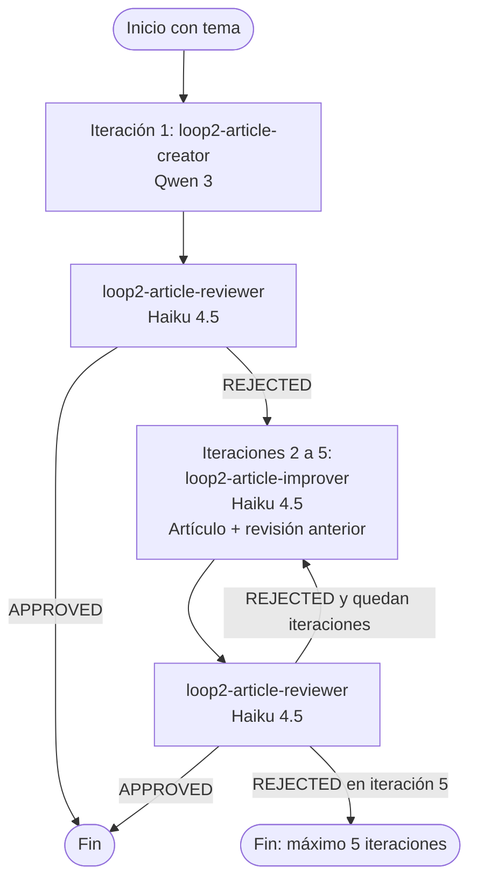

# Loop 2: Refinamiento de artículos

Un loop educativo con tres agentes locales de Kiro CLI:

1. `loop2-article-creator` crea un artículo de menos de 100 palabras con Qwen 3.
2. `loop2-article-improver` lo mejora y conserva el límite de 100 palabras con Haiku 4.5.
3. `loop2-article-reviewer` lo evalúa con métricas simples y responde `APPROVED` o `REJECTED` con Haiku 4.5.

El artículo y la revisión se mantienen en variables del shell: no se crean ficheros de trabajo. Cada iteración imprime su número, el artículo y la revisión. El loop termina cuando el revisor aprueba o después de cinco iteraciones.

## Flujo



## Ejecutar

```sh
sh Loop2/refine_article_loop.sh "explica que es Loop engineering"
```

El argumento es el tema del artículo en lenguaje natural. Por ejemplo:

```sh
sh Loop2/refine_article_loop.sh "cómo la lectura mejora la creatividad"
```
