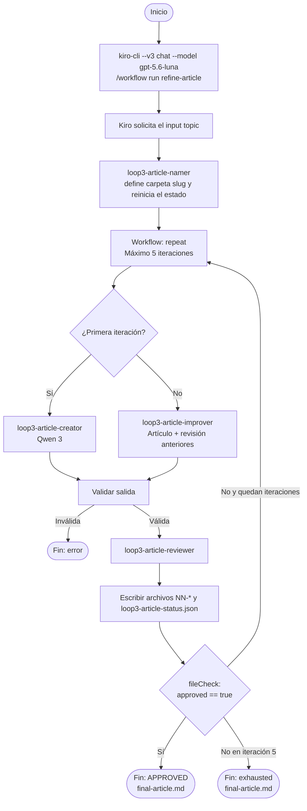

# Loop3: refinamiento declarativo con Kiro Workflows

Loop3 muestra un loop editorial ejecutado por Kiro Workflows, sin trasladar el loop al shell. Primero un agente nombra la carpeta de la ejecución a partir del tema. Después el Workflow repite como máximo cinco vueltas: `loop3-article-creator` crea la primera versión, `loop3-article-improver` mejora tras un rechazo y `loop3-article-reviewer` revisa cada vuelta. `fileCheck` detiene la repetición cuando `loop3-article-status.json` tiene `approved: true`.

Cada vuelta deja sus archivos en una carpeta propia del tema, con prefijos que reflejan el orden de ejecución, de modo que se puede seguir el proceso completo sin que nada se sobrescriba.

El demo está diseñado para ejecutarse de forma secuencial, una instancia cada vez en este workspace. El estado de control (`loop3-article-status.json`) usa una ruta fija, así que dos ejecuciones simultáneas se pisarían. Para concurrencia usa workspaces o worktrees separados.

## Flujo



## Prerrequisitos

- `kiro-cli` instalado y autenticado. Comprueba con `kiro-cli --version`.
- Los modelos `qwen3-coder-next` (creator) y `claude-haiku-4.5` (resto de agentes) disponibles. Comprueba con `kiro-cli chat --list-models --format plain`.
- Workflows habilitados en Kiro CLI. Abre una sesión V3, ejecuta `/settings` → **Features**, activa **Workflows**, sal del CLI y vuelve a iniciarlo.

## Ejecutar el demo

Desde la raíz del workspace:

```sh
kiro-cli --v3 chat --model gpt-5.6-luna
```

En el chat:

```text
/workflow run refine-article
```

Kiro solicita el `topic` porque la receta lo declara como input de tipo `prompt`, e inicia el Workflow. No hace falta crear ids, tokens ni carpetas previas.

## Agentes y contratos

| Rol | Modelo | Contrato |
|---|---|---|
| `loop3-article-namer` | `claude-haiku-4.5` | Una vez antes del loop. Calcula un slug del tema (`[a-z0-9-]`), crea la carpeta dentro de Loop3 (si existe, añade `-2`, `-3`...), escribe `run-info.json` y reinicia `loop3-article-status.json` (`initialized`, iteración 0). Devuelve el nombre de la carpeta. |
| `loop3-article-creator` | `qwen3-coder-next` | Sólo artículo original, claro, sin Markdown ni explicación, menos de 100 palabras. |
| `loop3-article-improver` | `claude-haiku-4.5` | Recibe tema, artículo actual y revisión anterior completos; devuelve sólo el artículo mejorado, menos de 100 palabras. |
| `loop3-article-reviewer` | `claude-haiku-4.5` | Revisa límite, claridad ≥8/10, coherencia ≥8/10, originalidad ≥6/10 y ortografía; la primera línea debe ser `APPROVED` o `REJECTED`. |
| `loop3-article-orchestrator` | `claude-haiku-4.5` | Una sola vuelta mediante `read`, `write` y `subagent`. Sin shell, Python ni hooks. |

### Contrato de respuesta de los subagents

Lo que un subagent entrega a quien lo llama es el campo `response` de su herramienta `subagent_response`, no el texto de su mensaje de chat. Si el creator escribe el artículo en el chat y pone en `response` un resumen ("Escribí un artículo..."), el orchestrator recibe el resumen. Esto causó fallos en las primeras pruebas, y se vio en los logs de sesión (`~/.kiro/sessions/.../sub-executions/`). Por eso los prompts de creator, improver y reviewer exigen poner el texto completo en `response`.

### Qué hace el orchestrator en cada vuelta

1. Lee `loop3-article-status.json` (puntero y gate) y obtiene `runDir`. Sólo continúa desde `initialized` o desde un `rejected` no terminal.
2. Marca `running` antes de delegar.
3. Iteración 1: llama al creator. Iteración 2 o más: guarda el payload exacto en `NN-1-input.txt` y llama al improver con el artículo y la revisión anteriores.
4. Valida la salida: no vacía, menos de 100 palabras y que no parezca un mensaje al usuario. Si falla, la guarda en `NN-2-rejected-output.txt` y termina con `error`.
5. Guarda el artículo, llama al reviewer, guarda la revisión.
6. Decide: `approved` si la revisión contiene `APPROVED` y no contiene `REJECTED`.
7. Escribe el estado final, relee todo y avisa con `send_message`.

La selección creator/improver y la validación dependen del protocolo del agente: la receta no ofrece una condición declarativa sobre el contenido de archivos, un parser JSON/schema ni un `finally` ante cancelación. Son coordinación instruida, no garantías del runtime. Lo que sí garantiza el Workflow es `repeat` con máximo 5 y `fileCheck` sobre `approved`.

## Archivos de salida

El estado de control tiene una ruta fija porque el `fileCheck` la necesita:

```text
.kiro/workflow-output/loop3-article-status.json
```

Todo lo demás se guarda en la carpeta `Loop3/<slug>` del tema.

```text
Loop3/geotermia/
├── run-info.json
├── 01-2-article.md
├── 01-3-review.txt
├── 01-4-status.json
├── 02-1-input.txt
├── 02-2-article.md
├── 02-3-review.txt
├── 02-4-status.json
└── final-article.md
```

El nombre sigue `NN-P-nombre`: `NN` es la iteración y `P` el paso dentro de ella (1 entrada del improver, 2 artículo, 3 revisión, 4 estado). Al ordenar por nombre se ve el orden real. La iteración 1 no tiene `01-1-input.txt` porque el creator sólo recibe el tema. `final-article.md` se crea al aprobar o agotar las iteraciones. Si una salida generada no pasa la validación, queda en `NN-2-rejected-output.txt`.

`loop3-article-status.json` contiene `topic`, `runDir`, `iteration`, `articlePath`, `reviewPath`, `finalArticlePath`, `status`, `phase`, `approved`, `terminal` y `error`. Las rutas son relativas a la raíz del workspace y los resultados editoriales quedan dentro de `Loop3/` (no a `.kiro/workflow-output/`), para que quien lea sólo el estado, por ejemplo el chat padre, sepa dónde están los archivos. Estados editoriales: `initialized`, `running`, `rejected`, `approved`, `exhausted`, `error`. Cada `NN-4-status.json` es una copia del estado al cerrar esa vuelta.

### Observabilidad

- Mientras corre, mira la carpeta del tema: cada archivo aparece al terminarse su paso.
- La vista **Artifacts** del Workflow muestra los artifacts de la receta (sólo el estado) en los checkpoints; no es streaming.
- Una cancelación puede dejar archivos parciales o un estado `running`. Revisa su contenido antes de reintentar. Un nuevo `/workflow run` reinicia el estado, pero conserva la carpeta anterior.

En el chat padre:

- `/workflow` abre el historial y permite seleccionar un run y su monitor.
- `/workflow status <workflowId>` muestra el estado de un run conocido.

El estado editorial y el del Workflow son distintos: Kiro puede reportar `running`, `paused`, `completed`, `failed` o `aborted`, mientras `exhausted` es un resultado editorial que puede terminar con el Workflow completado. Un `error` editorial termina con el step en `failed`.

### Logs de sesión

Para diagnosticar un fallo, los logs de sesión de Kiro contienen las respuestas completas de cada subagent: `~/.kiro/sessions/<hash>/<sesión>/sub-executions/<id>.jsonl`, y el estado del Workflow en `~/.kiro/sessions/<hash>/workflows/<workflowId>/workflow-state.json`.

## Seguridad de escritura

Las restricciones de ruta (el orchestrator sólo escribe en la carpeta del tema y en el status; el namer, en esa carpeta y el status) están en los prompts, no en permisos del runtime. Un agente que se desvíe podría escribir en otro sitio.

## Validación

```sh
jq empty .kiro/workflows/refine-article.workflow.json .kiro/agents/*.json
kiro-cli agent validate --path .kiro/agents/loop3-article-namer.json
kiro-cli agent validate --path .kiro/agents/loop3-article-creator.json
kiro-cli agent validate --path .kiro/agents/loop3-article-improver.json
kiro-cli agent validate --path .kiro/agents/loop3-article-reviewer.json
kiro-cli agent validate --path .kiro/agents/loop3-article-orchestrator.json
```

La validación oficial de la receta se solicita desde el chat padre, sin lanzar el run:

```text
Run validate_workflow on .kiro/workflows/refine-article.workflow.json. Report every error and warning, and do not launch the Workflow.
```

No se modifican ni dependen de Loop2. El loop no se ejecuta mediante shell, Python o hooks; el runtime de Kiro controla el `repeat` y el `fileCheck`.

## Documentación oficial

- [Kiro LLM index](https://kiro.dev/llms.txt)
- [Workflows](https://kiro.dev/docs/workflows.md)
- [Author workflows](https://kiro.dev/docs/workflows/authoring.md)
- [Run and manage workflows](https://kiro.dev/docs/workflows/manage.md)
- [Creating custom agents](https://kiro.dev/docs/custom-agents/creating.md)
- [Invoking as sub-agents](https://kiro.dev/docs/custom-agents/subagents.md)
