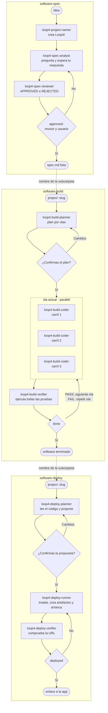

# Loop4: desarrollo de software con tres Kiro Workflows

Loop4 lleva el patrón de Loop3 a un desarrollo de software completo. Tres workflows comparten una carpeta física de proyecto dentro de `Loop4/`:

1. `software-spec`: un analista conversa contigo y mantiene la especificación; un revisor evalúa cada versión. Termina cuando el revisor y tú la aprobáis.
2. `software-build`: un planificador convierte la especificación en un plan por olas y te pide confirmación. Después, tres carriles de codificación trabajan en paralelo en cada ola y un verificador ejecuta todas las pruebas antes de avanzar.
3. `software-deploy`: un planificador lee el código y te propone cómo desplegarlo en local. Cuando lo confirmas, un runner lo instala y arranca en `deploy/`, y un verificador comprueba que responde y te da el enlace.

Igual que en Loop3, el runtime de Kiro controla la repetición (`repeat`) y la parada (`fileCheck`). Los agentes sólo hacen una vuelta cada vez. Cada proyecto creado por Loop4 contiene su propio `workflow-output/`; la salida final siempre queda exactamente en `<raíz-del-workspace>/Loop4/<subcarpeta-del-proyecto>/workflow-output/`, nunca en la raíz del workspace ni en una carpeta global compartida.

## Flujo



## Prerrequisitos

- Kiro IDE instalado y autenticado.
- Modelos `gpt-5.6-luna` y `claude-haiku-4.5` disponibles.
- Workflows habilitados para el workspace que contiene `.kiro/workflows/`.

## Ejecutar

Ejecutaremos Loop4 desde el **IDE de Kiro**, no desde la CLI. Las interacciones Human in the Loop —las preguntas que el modelo no puede responder por sí mismo y las confirmaciones del usuario— funcionan mejor en la interfaz del IDE, donde puedes abrir el monitor del workflow y responder directamente en el paso pausado.

Abre en Kiro el workspace que contiene `.kiro/workflows/` y la carpeta `Loop4/`; ejecuta el workflow desde el chat:

### 1. Especificación

```text
/workflow-run software-spec idea="Software a desarrollar"
```

Kiro te pide la `idea`. El namer crea una carpeta física como `Loop4/software-a-desarrollar` (o `Loop4/software-a-desarrollar-2` si ya existe) y devuelve esa ruta. En cada ronda el analista hace hasta 5 preguntas y el run queda en pausa (**needs input**). Responde desde el monitor **Workflows** del IDE: selecciona el run, abre el paso `analyst` pausado y escribe allí tu respuesta. También puedes pedir al chat principal que la envíe al paso.

Si el revisor rechaza la spec, no te pregunta nada: sólo revisa el documento. El loop vuelve al analista, que abre una sesión nueva (otro paso `analyst` en el monitor, el de la ronda siguiente) con preguntas sobre los huecos señalados. El run queda en **paused · needs input**: selecciona ese nuevo paso `analyst`, no el de la ronda anterior. Las preguntas también quedan en `Loop4/<subcarpeta>/spec/NN-1-conversation.md`.

Cuando el revisor aprueba, el analista te enseña un resumen y te pide la aprobación. Escribe algo como "Apruebo la especificación sin cambios". Al final el revisor te dice el nombre de la subcarpeta del proyecto y el comando para implementarlo.

### 2. Implementación

Cuando la especificación esté aprobada, ejecuta desde el chat del IDE pasando sólo el nombre de la subcarpeta de `Loop4/`, sin el prefijo `Loop4/`:

```text
/workflow-run software-build project=<subcarpeta-del-proyecto>
```

Por ejemplo, `project=trello-clone`. La receta construye la ruta física `Loop4/<subcarpeta-del-proyecto>` por su cuenta.

El planificador escribe `Loop4/<subcarpeta-del-proyecto>/plan/plan.md` y pausa para que lo confirmes, igual que en el paso anterior. Si pides cambios, rehace el plan y vuelve a preguntar. Al confirmar, el workflow sigue solo hasta terminar todas las olas.

### 3. Despliegue

Con el software terminado, lanza la receta `software-deploy` con el mismo nombre:

```text
/workflow-run software-deploy project=<subcarpeta-del-proyecto>
```

El planificador lee el código de `app/` y escribe `Loop4/<subcarpeta-del-proyecto>/deploy/proposal.md`: stack, qué va a instalar, artefactos, comandos, puerto y URL. Pausa para que la confirmes en el paso `planner`. Al confirmar, el runner instala, crea `start.sh` y `stop.sh` en `deploy/` y arranca la app en segundo plano. El verificador comprueba que el proceso está vivo y que la URL responde; si falla, el runner lo reintenta con el informe (hasta 3 intentos). Al terminar te envía el enlace, por ejemplo `http://127.0.0.1:3000/`.

La app sigue en marcha cuando acaba el workflow. Párala con `Loop4/<subcarpeta-del-proyecto>/deploy/stop.sh` y vuelve a arrancarla con `deploy/start.sh`.

## Agentes

| Agente | Workflow | Modelo | Herramientas | Qué hace |
|---|---|---|---|---|
| `loop4-project-namer` | spec | `claude-haiku-4.5` | read, write | Crea la carpeta física `Loop4/<slug>` y reinicia el estado dentro de ella. Devuelve `Loop4/<slug>`. |
| `loop4-spec-analyst` | spec | `gpt-5.6-luna` | read, write, web | Una ronda: pregunta, espera tu respuesta y reescribe `Loop4/<slug>/spec.md`. Registra si la apruebas. Puede buscar en internet si lo necesita. |
| `loop4-spec-reviewer` | spec | `gpt-5.6-luna` | read, write | Revisa sólo el documento y escribe el gate `approved` dentro del proyecto físico. |
| `loop4-build-planner` | build | `gpt-5.6-luna` | read, write, shell | Recibe `project` (`<slug>`), escribe el plan por olas y lo acuerda contigo. |
| `loop4-build-coder` | build | `gpt-5.6-luna` | read, write, shell | Implementa el grupo de su carril en la ola actual, con sus pruebas. |
| `loop4-build-verifier` | build | `gpt-5.6-luna` | read, write, shell | Ejecuta todas las pruebas, decide PASS o FAIL y avanza la ola. |
| `loop4-deploy-planner` | deploy | `gpt-5.6-luna` | read, write, shell | Lee el código, elige un puerto libre, escribe la propuesta de despliegue local y la acuerda contigo. |
| `loop4-deploy-runner` | deploy | `gpt-5.6-luna` | read, write, shell | Instala, crea los artefactos en `deploy/` y arranca la app en segundo plano. No modifica el código de `app/`. |
| `loop4-deploy-verifier` | deploy | `gpt-5.6-luna` | read, write, shell | Comprueba que el proceso vive y la URL responde, escribe el gate `deployed` y te entrega el enlace. |

Los perfiles están en `.kiro/agents/*.json` y sus prompts en `.kiro/agents/prompts/*.md`, para que se lean con comodidad. Las recetas fijan `gpt-5.6-luna` con esfuerzo `medium` para todos los pasos, y el paso `namer` lo cambia a `claude-haiku-4.5`.

## Decisiones de diseño

- **Nombre de proyecto como entrada.** El namer crea y devuelve `Loop4/<slug>`, relativa a la raíz del workspace, y `software-spec` usa esa salida para todos sus `fileCheck` y artifacts. `software-build` y `software-deploy` reciben sólo `project=<slug>` y construyen en la receta la ruta `Loop4/{{project}}` para sus `fileCheck`, artifacts y prompts. `<slug>` es el nombre real de la subcarpeta, incluido el sufijo `-2`, `-3`... si lo tiene, y coincide con el campo `project` de `project.json`. Los planificadores rechazan un `project` que no sea una subcarpeta existente de `Loop4/` (por ejemplo, si incluye `Loop4/` o `/`).
- **Doble aprobación con un solo gate.** `fileCheck` mira un único campo. El analista anota `userApproved` y el revisor escribe `approved = reviewDecision == APPROVED && userApproved`. Así, el gate lo escribe el agente independiente, como en Loop3.
- **Paralelismo con carriles fijos.** Las ramas de `parallel` se escriben fijas en la receta, pero el plan se genera durante la ejecución. Por eso hay tres carriles fijos: en cada ola, el carril K implementa el grupo K si existe y, si no, termina sin hacer nada.
- **Sin conflictos entre carriles.** El plan asigna cada archivo a un único grupo. Sólo la ola 1 (andamiaje) instala dependencias.
- **Fallo honesto.** Si las pruebas fallan, el verificador no avanza la ola: los carriles reciben la salida de las pruebas y la corrigen. Los dos `repeat` usan `onMaxIterations: pause` (10 rondas de especificación, 15 iteraciones de build).
- **Despliegue sólo local.** Las apps generadas no tienen autenticación, así que la propuesta las hace escuchar en `127.0.0.1`. El verificador avisa si un puerto queda abierto en todas las interfaces.
- **El despliegue no reescribe la app.** El runner sólo instala, compila y arranca. Si la app no arranca sin cambiar código, el verificador marca FAIL con el motivo en vez de tapar el problema.
- **Las pausas para hablar contigo** usan `completion: { completionSignal: success }`. El paso queda abierto hasta que el agente termina con `success`, y cada pregunta es un `send_message` con severity `warning`.

Como en Loop3, la selección de trabajo por carril, las validaciones y las rutas de escritura dependen de los prompts. El runtime sólo garantiza `repeat`, `parallel`, `completion` y `fileCheck`.

## Archivos

El estado de control vive dentro de cada carpeta física de proyecto porque lo necesitan los `fileCheck`:

```text
Loop4/<subcarpeta-del-proyecto>/workflow-output/loop4-spec-status.json
Loop4/<subcarpeta-del-proyecto>/workflow-output/loop4-build-status.json
Loop4/<subcarpeta-del-proyecto>/workflow-output/loop4-deploy-status.json
```

`software-spec` resuelve la ruta con la salida física de `loop4-project-namer`. `software-build` y `software-deploy` la construyen como `Loop4/{{project}}`. Así, varias ejecuciones crean carpetas distintas (`Loop4/<slug>`, `Loop4/<slug>-2`...) y no comparten gates ni sobrescriben el estado de otra ejecución.

Todo lo demás queda en la carpeta física del proyecto dentro de `Loop4/`:

```text
Loop4/<subcarpeta-del-proyecto>/
├── workflow-output/
│   ├── loop4-spec-status.json
│   ├── loop4-build-status.json
│   └── loop4-deploy-status.json
├── project.json
├── spec.md                  especificación vigente
├── spec/
│   ├── 01-1-conversation.md preguntas y tu respuesta
│   ├── 01-2-spec.md         versión de la spec en esa ronda
│   ├── 01-3-review.md        revisión: APPROVED o REJECTED + huecos
│   └── ...
├── plan/
│   ├── plan.md              para personas
│   └── plan.json             para agentes: olas, carriles, archivos, testCommand
├── build/
│   ├── 01-1-lane-1.md       informe de cada carril con trabajo
│   ├── 01-2-tests.txt       salida completa de las pruebas
│   ├── 01-3-status.json     copia del estado tras verificar
│   └── ...
├── app/                     código y pruebas unitarias
└── deploy/
    ├── proposal.md          propuesta de despliegue para personas
    ├── proposal.json        para agentes: comandos, puertos, url, approved
    ├── start.sh, stop.sh    artefactos de despliegue
    ├── app.pid, app.log     proceso en marcha y su salida
    ├── 01-1-run.md          informe del runner
    ├── 01-1-install.log     salida de instalación y build
    ├── 01-2-verify.md       comprobaciones del verificador
    ├── 01-3-status.json     copia del estado tras verificar
    └── ...
```

Los nombres siguen `NN-P-nombre`, como en Loop3: `NN` es la ronda o la iteración y `P`, el paso dentro de ella.

## Permisos

Los agentes tienen permisos amplios para que puedan instalar y ejecutar lo que necesite el stack elegido: escritura en todo el workspace y shell sin restricciones, salvo `sudo` y `git push`. Las rutas donde escribe cada agente están limitadas sólo por sus prompts. Si algo se bloquea, amplía las reglas `permissions` del agente en su `.json`.

## Limitaciones

- Una ejecución cada vez por carpeta física de proyecto: los archivos de estado son fijos dentro de `Loop4/<subcarpeta>/workflow-output/`. `software-build` comprueba la aprobación en la misma ruta física, así que lánzalo antes de empezar otra especificación en ese proyecto.
- Las respuestas al analista y al planificador se dan en la sesión del paso, no como un mensaje normal en el chat principal.
- Cada ronda del analista es una sesión nueva: su memoria son `spec.md`, la conversación y la última revisión.
- `parallel` no garantiza menos tiempo total. Aquí sirve para que los carriles trabajen aislados.
- La app desplegada queda en marcha hasta que ejecutes `deploy/stop.sh`. Si reinicias el equipo, vuelve a arrancarla con `deploy/start.sh`.
- `software-deploy` sólo despliega en local. Las dependencias se instalan donde las espera el stack (por ejemplo `app/node_modules`).
- Cancelar un run no deshace los cambios en los archivos. Un nuevo `software-spec` crea otra carpeta (`Loop4/<slug>-2`...).

## Ejemplo incluido

`Loop4/google-keep-clone/` y `Loop4/trello-clone/` son resultados de pruebas de extremo a extremo. Sus artefactos de aplicación permanecen dentro de sus respectivas subcarpetas; una nueva ejecución debe crear otra carpeta con sufijo para conservar el aislamiento. La salida de control esperada para cualquier nueva ejecución es `Loop4/<subcarpeta>/workflow-output/`.

## Validación

Desde la raíz del workspace:

```sh
jq empty .kiro/workflows/*.json .kiro/agents/*.json
for f in .kiro/agents/*.json; do kiro-cli agent validate --path "$f"; done
kiro-cli --v3 agent list | grep -E "loop4-project-namer|spec-|build-|deploy-"
```

También puedes comprobar la propiedad clave de las recetas con estas aserciones:

```sh
python3 - <<'PY'
import json
from pathlib import Path

root = Path.cwd()
spec = json.loads((root / ".kiro/workflows/software-spec.workflow.json").read_text())
build = json.loads((root / ".kiro/workflows/software-build.workflow.json").read_text())
assert spec["steps"][0]["captureOutput"] is True
assert spec["steps"][1]["stopCondition"]["fileCheck"]["path"] == "{{namer.output}}/workflow-output/loop4-spec-status.json"
deploy = json.loads((root / ".kiro/workflows/software-deploy.workflow.json").read_text())
for recipe in (build, deploy):
    assert recipe["inputs"] == {"project": "string"}
    assert "{{projectDir}}" not in json.dumps(recipe)
    assert all("Loop4/{{project}}" in json.dumps(node) for node in recipe["steps"])
assert build["steps"][1]["stopCondition"]["fileCheck"]["path"] == "Loop4/{{project}}/workflow-output/loop4-build-status.json"
assert deploy["steps"][1]["stopCondition"]["fileCheck"]["path"] == "Loop4/{{project}}/workflow-output/loop4-deploy-status.json"
for slug in ("google-keep-clone", "trello-clone"):
    meta = json.loads((root / "Loop4" / slug / "project.json").read_text())
    assert meta["project"] == slug and meta["projectDir"] == f"Loop4/{slug}", slug
assert deploy["steps"][1]["steps"][-1]["agent"] == "loop4-deploy-verifier"
assert Path("Loop4/google-keep-clone").is_dir()
expected = Path("Loop4/google-keep-clone/workflow-output")
assert str(expected).startswith("Loop4/") and expected.parent.name == "google-keep-clone"
for recipe in (spec, build, deploy):
    assert "/.kiro/workflow-output" not in json.dumps(recipe)
prompts = root / ".kiro/agents/prompts"
for name in ("project-namer", "spec-analyst", "spec-reviewer", "build-planner", "build-coder",
             "build-verifier", "deploy-planner", "deploy-runner", "deploy-verifier"):
    text = (prompts / f"{name}.md").read_text()
    assert "/.kiro/workflow-output" not in text and "PROJECT_DIR/workflow-output/" in text, name
print("Loop4 path assertions: PASS ->", expected)
PY
```

## Documentación oficial

- [Workflows](https://kiro.dev/docs/workflows.md)
- [Author workflows](https://kiro.dev/docs/workflows/authoring.md)
- [Run and manage workflows](https://kiro.dev/docs/workflows/manage.md)
- [Agent configuration reference](https://kiro.dev/docs/custom-agents/configuration-reference.md)
- [Permissions](https://kiro.dev/docs/permissions.md)
